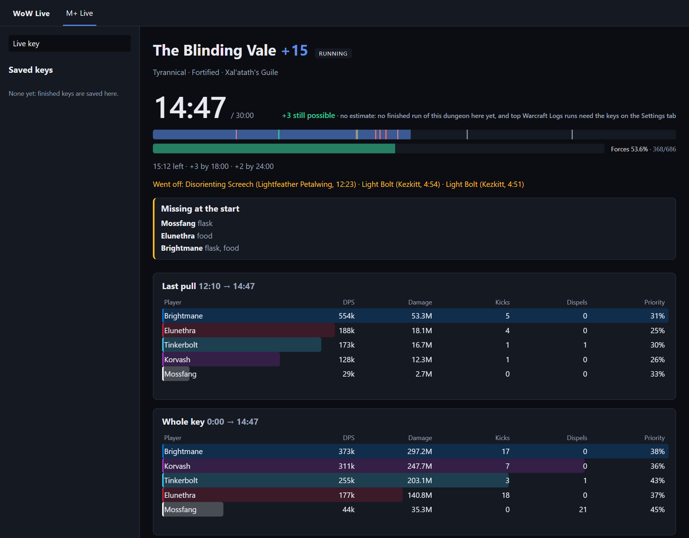
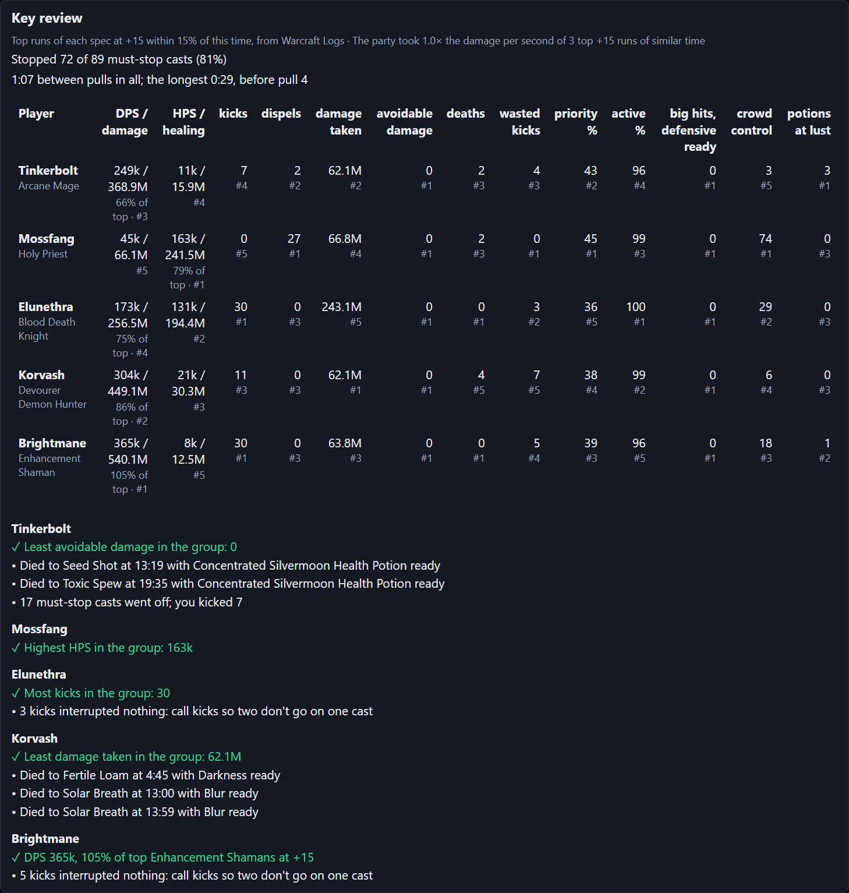
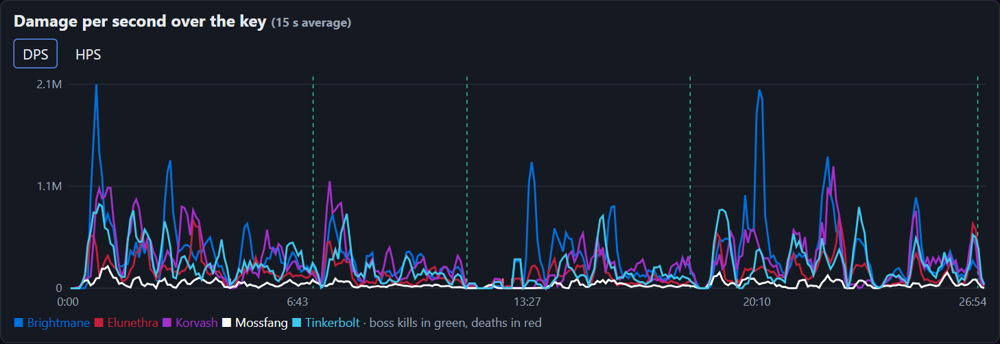

# WoW Live

A Windows app for World of Warcraft Mythic+ keys. It reads the game's combat log on your PC as the game writes it and shows the key live, in its own window and as an overlay over the game, then reviews each player after the key.

It's not an addon and doesn't touch the game: it only reads the combat log file the game writes when Advanced Combat Logging is on. Nothing is uploaded, and nothing listens on the network.

After the key: the review and the damage graph

*Screenshots from a replay of a real key, with the players' names made up.*

## Install

1. Get it from the [Microsoft Store](https://apps.microsoft.com/detail/9pfg7vnt6j89). [steezy2/wow-live](https://github.com/steezy2/wow-live) is its public page, for issues and the privacy policy.
2. In the game, turn on **Advanced Combat Logging** (Options > System > Network) and type `/combatlog` before the key.
3. Optional, for the review and a dungeon's first estimate: with your Battle.net account linked to Warcraft Logs, make a Warcraft Logs API client at [warcraftlogs.com/api/clients](https://www.warcraftlogs.com/api/clients) (redirect URL `http://localhost`, *Public Client* left unchecked) and paste its ID and secret in the **Settings** tab before closing that page.

Play in Windowed or Windowed (Fullscreen) so the overlay shows over the game.

## What it shows

- **Before the key:** in a Mythic dungeon, a ready check of who's missing a flask, food or a party buff, from the buffs the log has shown since the party zoned in. The game often writes those lines only as the key starts, so the check that counts is the one at the start: who's missing what, on the page for the whole key and on the overlay for its first 30 seconds.
- **During the key** (the game writes its log in batches as fights start and end, so a pull's numbers arrive when it's over):
  - the clock against the timer, death penalty included, with the +2 and +3 marks, and enemy forces as the dungeon's count, with how much faster or slower you are than your best timed run at that level;
  - the result it's heading for, with a range and the odds of each, from your earlier runs' forces and boss times (a dungeon's first run uses its top Warcraft Logs runs at that level);
  - each death with what killed the player and which defensives they still had ready;
  - interrupts, the must-stop casts that went off, crowd control, dispels, and the worst bursts of damage with each player's cover;
  - DPS, HPS, damage taken and avoidable damage for the last pull and the whole key.
- **After the key:** a review of each player against their spec's top runs on Warcraft Logs and their own earlier runs (DPS and HPS, priority damage, active time, kicks, dispels, avoidable damage, deaths with a defensive ready, potions with Bloodlust), with up to four things to work on and one done well, and the party's own list (what deaths cost, must-stop casts stopped, time between pulls, Bloodlusts missed, late minibosses); beside it, one player's key up close (their damage and healing by ability with casts and hits, what they took damage from, and what they cast); a damage or healing per second graph and the boss fights (each against your best run and the top runs), where a click moves the replay on Keystone.guru's maps. An abandoned key gets the same, over the time it ran. The game logs no end for a key the party left: the app ends it when the log shows them leaving, after 10 minutes without a line, or when you press *Abandoned key* (it runs again if the log goes on in it for 2 more minutes).
- **Overlay:** see-through and click-through. Ctrl+Alt+O (or *Move overlay* in Settings) moves and resizes it; Settings also has when it shows, its background opacity and one or two cards.

Settings, saved keys and the log are in the Store package's own folder, which uninstalling removes; a build run from `bin/` keeps them in `%LOCALAPPDATA%\WoW Live`. Warcraft Logs keys are kept in Windows Credential Manager. Nothing from the combat log leaves your PC: see the [privacy policy](https://github.com/steezy2/wow-live/blob/master/PRIVACY.md).

## Working on it

- **Layout:** `backend/` is one Go module: `clients/` for the outside systems (the combat log, Warcraft Logs, Raider.IO, Keystone.guru), `models/` for the shared types, `service/` for the rules, `controller/` for the Gin API, `app/` wiring them, and `cmd/` for the entry points. `frontend/` is the page, React + Vite + TypeScript. `mplus.toml` holds the spell and buff names it checks; `reference/mplus-dungeons.json` the season's dungeon facts.
- **Commands:** the `Makefile` has the everyday ones (Git Bash on Windows, with Go, Node and make); `make` lists them.
- **Build the app:** `make app` (`bash backend/cmd/app/build.sh`) writes `bin/WoW Live.exe`.
- **Checks:** `make check` runs `gofmt -l .`, `go vet ./...` and `go test ./...` in `backend/`, then `npm run lint`, `npm test` and `npm run build` in `frontend/`. CI runs them on every PR.
- **In a browser:** after `npm run build` in `frontend/`, `go run ./cmd/site` in `backend/` serves the same page and API at http://localhost:8080 (API spec at `/swagger/index.html`). `--replay PATH --key 2 --speed 30` plays a past log's 2nd key 30 times faster; `--learn` saves every finished key in the log folder. After changing an endpoint, regenerate the spec with `swag init -g cmd/site/main.go -o docs --parseInternal`.
- **Dungeon facts:** `make ref` (`go run ./cmd/mplusref`) rewrites `reference/mplus-dungeons.json` from Mythic Dungeon Tools (each mob's forces, the total checked against Keystone.guru's), Keystone.guru (map floors), Raider.IO (the season's dungeons) and Wowhead (spells); rerun it each season and check the diff. `make ref-check` lists the mobs your logged keys killed that it lacks: a second NPC ID of a mob it has goes in `npcTwins` (`backend/service/mplusref.go`).
- **Releases:** a `v*` tag packs `WoW Live.msix` (`backend/cmd/app/msix/pack.sh`) on GitHub Actions, with the identity from Partner Center's *Product identity* page in the repo's `MSIX_NAME`, `MSIX_PUBLISHER` and `MSIX_PUBLISHER_NAME` variables, keeps it on a release here and submits it to the Microsoft Store, which signs it (the `store` job, once the repo's `STORE_PRODUCT_ID` variable and the Entra secrets are set; it submits without an approval step, and fails while a submission made by hand in Partner Center is in progress).
- **Icon:** `backend/cmd/appicon/icon.svg` (and `icon-small.svg` under 48 px), rendered to the committed PNGs by `render.sh`. Original art, no Blizzard logos.

World of Warcraft is a trademark of Blizzard Entertainment; this project isn't affiliated with Blizzard. Maps are Keystone.guru's, credited on the page.

## Licence

Proprietary, all rights reserved: see [LICENSE](LICENSE).
