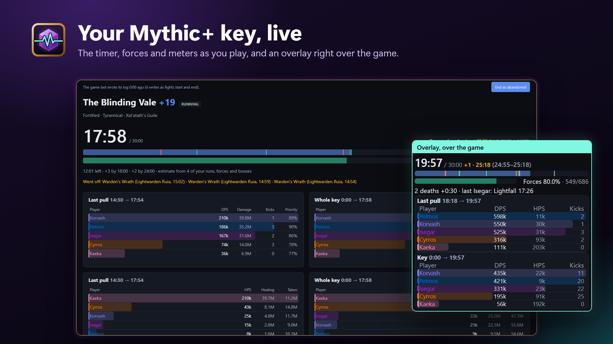
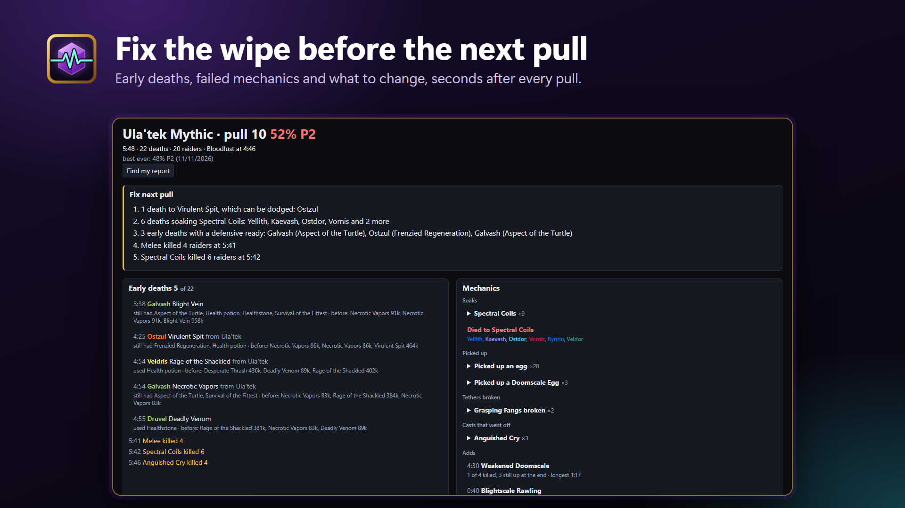
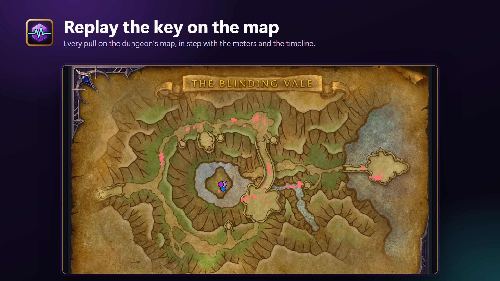
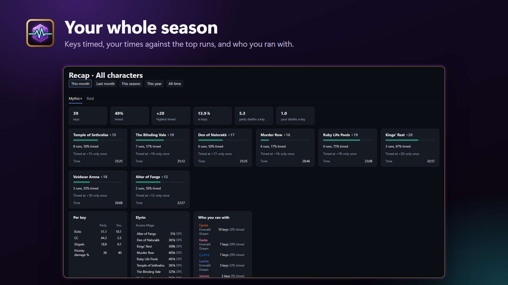

# WoW Live

A Windows app for World of Warcraft Mythic+ keys and raid pulls. It reads the game's combat log on your PC as the game writes it and shows the key live, in its own window and as an overlay over the game, then reviews each player after the key; in a raid, it shows each pull as it ends.

It's not an addon and doesn't touch the game: it only reads the combat log file the game writes when Advanced Combat Logging is on. Nothing is uploaded, and nothing listens on the network.

After the key and the pull: Fix next key, the raid's Fix next pull, death recaps, the map replay and the Recap

*Screenshots from a replay of a real key, with the players' names made up.*

## Install

1. Get it from the [Microsoft Store](https://apps.microsoft.com/detail/9pfg7vnt6j89).
2. In the game, turn on **Advanced Combat Logging** (Options > System > Network) and type `/combatlog` before the key.
3. Optional, for the review and a dungeon's first estimate: with your Battle.net account linked to Warcraft Logs, make a Warcraft Logs API client at [warcraftlogs.com/api/clients](https://www.warcraftlogs.com/api/clients) (redirect URL `http://localhost`, *Public Client* left unchecked) and paste its ID and secret in the **Settings** tab before closing that page.

Play in Windowed or Windowed (Fullscreen) so the overlay shows over the game.

## What it shows

- **At the start of a key:** who was missing a flask, food, rune or party buff (a party buff only when its class is in the group), in the key's Buffs tab.
- **During the key** (the game writes its log in batches as fights start and end, so a pull's numbers arrive when it's over):
  - the clock against the timer, death penalty included, with the +2 and +3 marks, and enemy forces as the dungeon's count, with how much faster or slower you are than your best timed run at that level;
  - the result it's heading for, with a range and the odds of each, from your earlier runs' forces and boss times (a dungeon's first run uses its top Warcraft Logs runs at that level);
  - each death with what killed the player and which defensives they still had ready;
  - interrupts, the must-stop casts that went off, crowd control, dispels, and the worst bursts of damage with each player's cover;
  - DPS, HPS, damage taken and avoidable damage for the last pull and the whole key (an Augmentation Evoker credited with what its buffs add, as on Warcraft Logs).
- **After the key:** a review of each player against their spec's top runs on Warcraft Logs and their own earlier runs (DPS and HPS, priority damage, active time, kicks, dispels, avoidable damage, deaths with a defensive ready, potions with Bloodlust), with up to four things to work on and one done well, and the party's own list (what deaths cost, must-stop casts stopped, time between pulls, Bloodlusts missed, late priority targets, and who put too little damage into them). The meter cards follow the replay, which opens at the end. A click on a player drills the cards into their damage by spell and into each enemy, and their healing and damage taken by ability, avoidable hits marked. Bottom tabs list damage spikes with what caused them, big hits (a player losing 40 to 50% of their health in 3 s and falling under 40%), what caused the avoidable damage, each player's defensives, potions and crowd control with when they used them, and priority targets. A click on a death or a big hit shows that player's last 10 s: health, hits, heals, shields and buttons pressed. Also a damage or healing per second graph and the boss fights (each against your best run and the top runs), where a click moves the replay on Keystone.guru's maps. An abandoned key gets the same, over the time it ran. The game logs no end for a key the party left: the app ends it when the log shows them leaving, after 10 minutes without a line, or when you press *End as abandoned* (it runs again if the log goes on in it for 2 more minutes). On the page: one focused player and one clock across the graph, map, Timeline of lanes (pulls, bosses, deaths, Bloodlust, potions, defensives, spikes, must-stops, crowd control), review and tabs (a click on a name, dot or time moves everything), a "Fix next key" list, your best timed run's time, and the replay's health box, casts and ability bars; a click on an enemy shows its casts.
- **Raid (Raid tab):** after each raid pull on any difficulty, how far it got (boss health and phase) against tonight's best and the best ever on the boss; the early deaths with what killed them, their last hits and the defensives still ready; mass kills; what went wrong by kind of mechanic (avoidable hits, who soaked each soak, what raiders picked up, tethers broken and what they set off, each add's spawn and its cause, stacks, dispels, must-stop casts, damage into the unit to burst); Bloodlust, raid cooldowns and combat potions; the pull's meters, a Raiders table (potions, healthstones, active time, avoidable damage) and the M+ tabs. At the top, a short list of what to fix on the next pull, then the early deaths and mechanics; under them a replay of the pull on the room's map (map art from Warcraft Logs) with a lane per mechanic and DPS and HPS graphs on the same clock. A click on a raider (on the map, a meter or the graph) focuses them everywhere, down to their abilities and targets; a right click goes back. Each night's pulls are listed on the side by boss, newest first. A "Missing buffs" card lists who lacked a flask, food, Vantus Rune or raid buff at the pull and for how long during it, and Kith'ix's light motes are checked for every living raider.
- **Your data (Home):** *Read old logs* saves the keys and pulls already in the log folder; *Archive* zips old logs into the folder's `WoW Live archive` (they stop loading and take a tenth of the space, and *Read everything again* still reads them), and archived logs can be deleted for good. On the **Home** tab, which also walks a first-time user through setup, the list includes Warcraft Logs imports (delete only) and the folders' sizes, and two optional auto rules (off by default) archive game logs read and this old and delete imports this long after they were imported. *Import from Warcraft Logs* lists a character's keys, raid kills and raid wipes of this season on Warcraft Logs with the points each would cost, then saves the kinds you tick as if the app had read their logs (it needs the Warcraft Logs keys and spends their points, always leaving the hour's last 200 for key reviews and parses: below them it waits for the next hour), tagged with a link to each fight; *Remove imported* takes them out again. Your own keys and pulls found in your Warcraft Logs reports get linked to them (a finished key or pull not linked yet has **Find my report**), and the Recap tab shows your character's parses.
- **Characters:** the top bar picks All characters or one of yours; the saved keys, raid nights and Recap follow it.
- **Recap tab:** this month, last month, this season, this year or all time, on a Mythic+ tab and a Raid tab. Mythic+: keys run, timed % and your deaths against the party's; each dungeon's runs, timed % and its average, median and fastest timed run at the highest level you timed, against Warcraft Logs' top runs there; kicks, CC, dispels and priority damage per key; who you ran with (class colour and realm); facts that open their key. Raid: pulls, kills and each boss. Both: your Warcraft Logs parses this season.
- **Routes tab:** plan a key's pulls from Mythic Dungeon Tools (MDT). Paste an MDT export string or import one of MDT's saved routes (MDT writes that file on `/reload` or logout), or start an empty route. Each dungeon's routes are listed with a star for the one the live page will follow; the picked route is drawn on the dungeon's map with every enemy a dot, each pull in its color and number, and a list of the pulls with their forces and the running total (green from 100%). Edit it in place: select a pull, click an enemy to move it into that pull (Shift+click for its whole pack), add, delete and move pulls, Undo, then Save. *Copy MDT string* gives a route back for MDT's Import. A key's **Route** tab puts the key next to its dungeon's route: each planned pull's kills and when it was pulled, the kills off the route and the pulls skipped. During a key, the live page and the overlay show "Next: pull N".
- **Overlay:** see-through. It scales to its window. A click on a player shows their top spells and damage into each enemy over that card's span (the last pull or the whole key; a right click goes back), and a click on the deaths line lists the deaths and opens a death's last 10 s; Ctrl+Alt+K (or the tray, or Settings) lets clicks through to the game instead. Between raid pulls it shows the last pull for a few minutes: how far it got, the first deaths, what to fix and the top DPS and HPS. Ctrl+Alt+O (or *Move overlay* in Settings) moves and resizes it; Settings also has when it shows, its background opacity, one or two cards, players per card and which columns.

Settings, saved keys and raid pulls, and the log are in the Store package's own folder, which uninstalling removes; a build run from `bin/` keeps them in `%LOCALAPPDATA%\WoW Live`. Warcraft Logs keys are kept in Windows Credential Manager. Importing a character downloads that character's public Warcraft Logs reports. Nothing from the combat log leaves your PC: see the [privacy policy](PRIVACY.md).

## Working on it

- **Layout:** `backend/` is one Go module: `clients/` for the outside systems (the combat log, Warcraft Logs, Raider.IO, Keystone.guru, Mythic Dungeon Tools, Wowhead, wago.tools) and the saved keys and raid pulls (`keystore`), `models/` for the shared types, `service/` for the rules, `controller/` for the Gin API, `app/` wiring them, and `cmd/` for the entry points. `frontend/` is the page, React + Vite + TypeScript. `mplus.toml` holds the spell and buff names it checks and `raid-rules.toml` the raid's thresholds, cooldowns and phase triggers; `reference/mplus-dungeons.json` the season's dungeon facts and `reference/raid-bosses.json` the raid's boss mechanics.
- **Commands:** the `Makefile` has the everyday ones (Git Bash on Windows, with Go, Node and make); `make` lists them.
- **Build the app:** `make app` (`bash backend/cmd/app/build.sh`) writes `bin/WoW Live.exe`.
- **Checks:** `make check` runs `gofmt -l .`, `go vet ./...` and `go test ./...` in `backend/`, then `npm run lint`, `npm test` and `npm run build` in `frontend/`. CI runs them on every PR.
- **In a browser:** after `npm run build` in `frontend/`, `go run ./cmd/site` in `backend/` serves the same page and API at http://localhost:8080 (API spec at `/swagger/index.html`). `--replay PATH --key 2 --speed 30` plays a past log's 2nd key 30 times faster; `--learn` saves every finished key and raid pull in the log folder's new or changed logs. After changing an endpoint, regenerate the spec with `swag init -g cmd/site/main.go -o docs --parseInternal`.
- **Dungeon facts:** `make ref` (`go run ./cmd/mplusref`) rewrites `reference/mplus-dungeons.json` from Mythic Dungeon Tools (each mob's forces, the total checked against Keystone.guru's), Keystone.guru (map floors), Raider.IO (the season's dungeons) and Wowhead (spells); rerun it each season and check the diff. `make ref-check` lists the mobs your logged keys killed that it lacks: a second NPC ID of a mob it has goes in `npcTwins` (`backend/service/mplusref.go`).
- **Raid bosses:** `go run ./cmd/raidref` rewrites `reference/raid-bosses.json` from `reference/raid-mechanics.toml` (each boss's mechanics, kept by hand and checked against logs) or else Wowhead's boss cheat sheets, and each boss's NPC IDs and rooms from a top Warcraft Logs kill with the rooms' edges from wago.tools (keys in `.env`; `--raid SLUG` for another raid); review the diff, and after a raid night `--check` lists abilities that hit some raiders often and others never that a boss's lists don't have. A phase's trigger, once found, goes in `raid-rules.toml`.
- **Releases:** a `v*` tag packs `WoW Live.msix` (`backend/cmd/app/msix/pack.sh`) on GitHub Actions, with the identity from Partner Center's *Product identity* page in the repo's `MSIX_NAME`, `MSIX_PUBLISHER` and `MSIX_PUBLISHER_NAME` variables, keeps it on a release here and submits it to the Microsoft Store, which signs it (the `store` job, once the repo's `STORE_PRODUCT_ID` variable and the Entra secrets are set; it submits without an approval step, and fails while a submission made by hand in Partner Center is in progress).
- **Icon:** `backend/cmd/appicon/icon.svg` (and `icon-small.svg` under 48 px), rendered to the committed PNGs by `render.sh`. Original art, no Blizzard logos.

World of Warcraft is a trademark of Blizzard Entertainment; this project isn't affiliated with Blizzard. Dungeon maps are Keystone.guru's and raid maps Warcraft Logs', credited on the page.

## Licence

[PolyForm Noncommercial 1.0.0](LICENSE): the source is public and free to read, run, change and share for any noncommercial purpose. Selling it, or using it in a paid product or service, needs the author's written permission.
